# 🏫 FacilityFix

<p align="center">
  <strong>A Smarter Way to Report, Track & Manage College Facility Issues</strong>
</p>

<p align="center">
  A structured web application that brings facility issue reporting and maintenance tracking into one organized workflow.
</p>

<p align="center">
  
</p>

<p align="center">
  
  
  
  
</p>

<p align="center">
  <a href="#overview">Overview</a> •
  <a href="#screenshots">Screenshots</a> •
  <a href="#features">Features</a> •
  <a href="#installation">Installation</a> •
  <a href="#testing">Testing</a> •
  <a href="#project-structure">Structure</a>
</p>

---

## Overview

**FacilityFix** is a web-based College Facility Issue Reporting and Tracking System built with Python, Flask, and SQLite.

It provides a centralized workflow for recording facility problems, following issue progress, and managing resolution information through role-based access.

Instead of relying entirely on informal reporting methods, FacilityFix organizes issues into a consistent process that reporters and facility coordinators can follow.

### The problem

Facility issues can be difficult to manage when reports are scattered across conversations, messages, or verbal communication. Tracking progress and maintaining a clear history can become challenging.

### The solution

FacilityFix provides:

- A structured form for reporting facility issues.
- Organized records of submitted issues.
- Issue status tracking.
- A dedicated coordinator management workflow.
- Resolution notes and issue history.
- Role-based access to application functionality.

### Project goals

- Make facility issue reporting more organized.
- Improve visibility into issue progress.
- Maintain consistent records.
- Support a defined issue resolution workflow.
- Demonstrate practical web development, database design, validation, and automated testing.

---

## Screenshots

The screenshots below demonstrate the application's interface and selected workflow stages.

> Ensure these image files are uploaded to the repository under the exact lowercase `screenshots/` directory.

### 01. Login

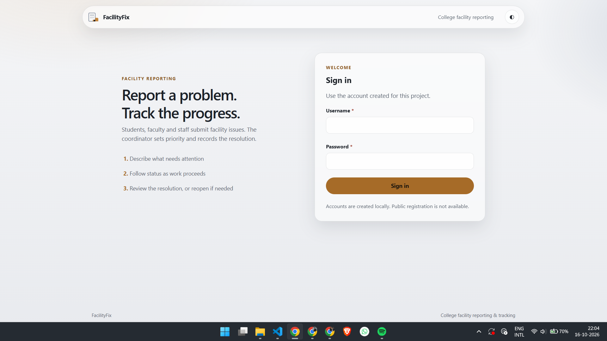

*The login page for registered users.*

### 02. Reporter Dashboard

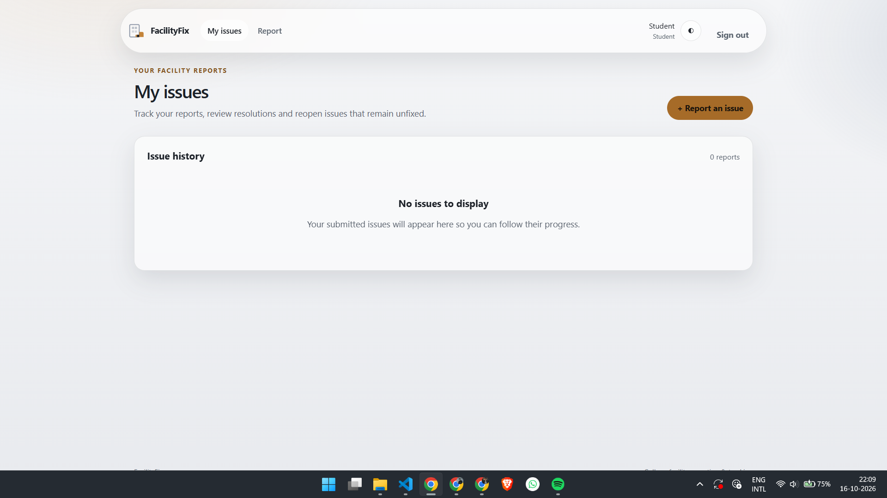

*The main dashboard for accessing reporter features.*

### 03. Issue Reporting Form

<p align="center">
  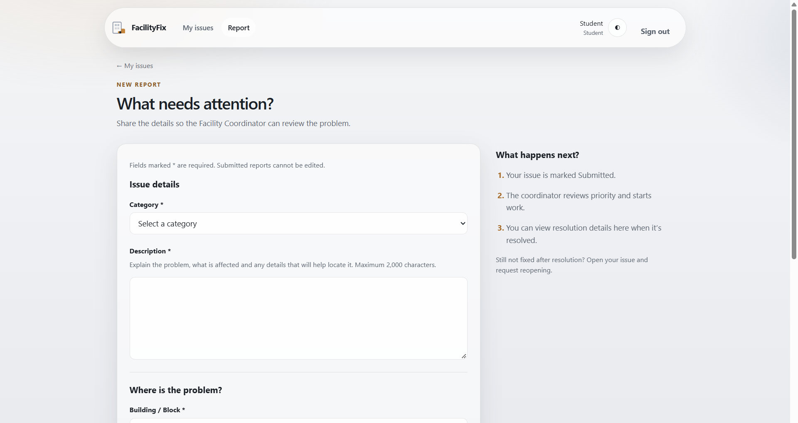
  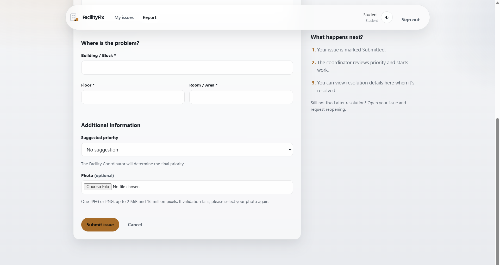
</p>

*The form used to submit a facility issue.*

### 04. Issue Submission

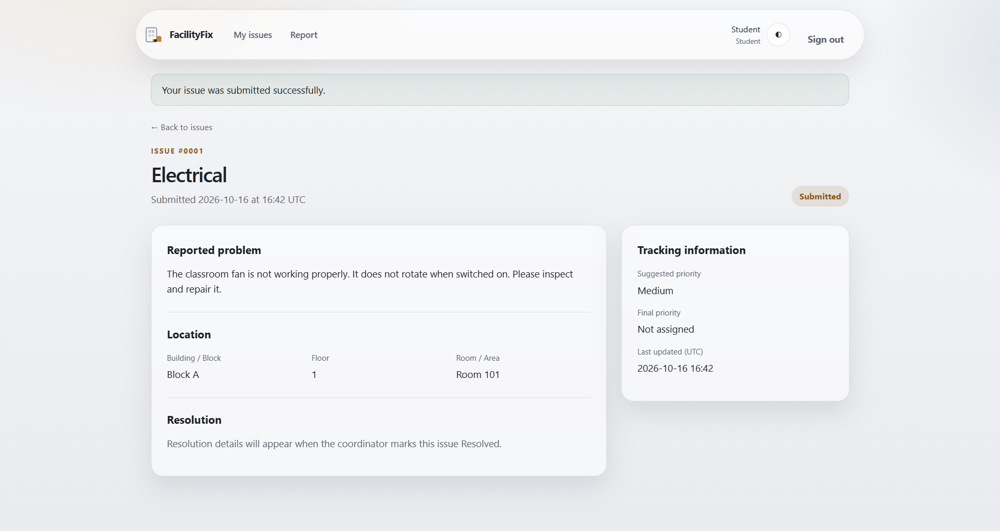

*The interface following issue submission.*

### 05. My Issues

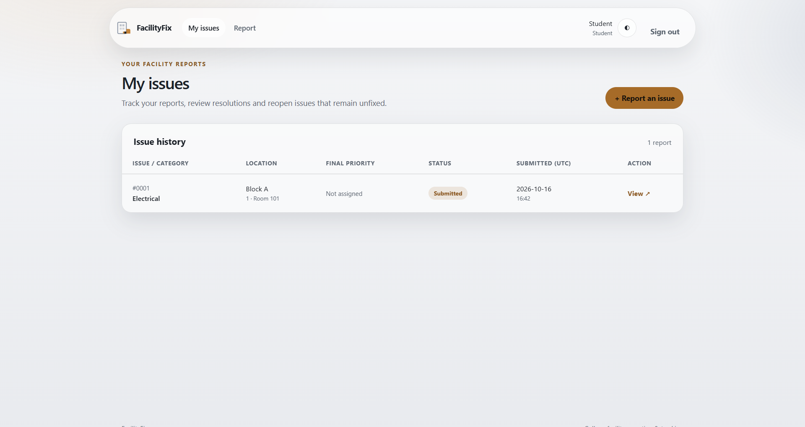

*The reporter's issue list and tracking view.*

### 06. Coordinator Dashboard

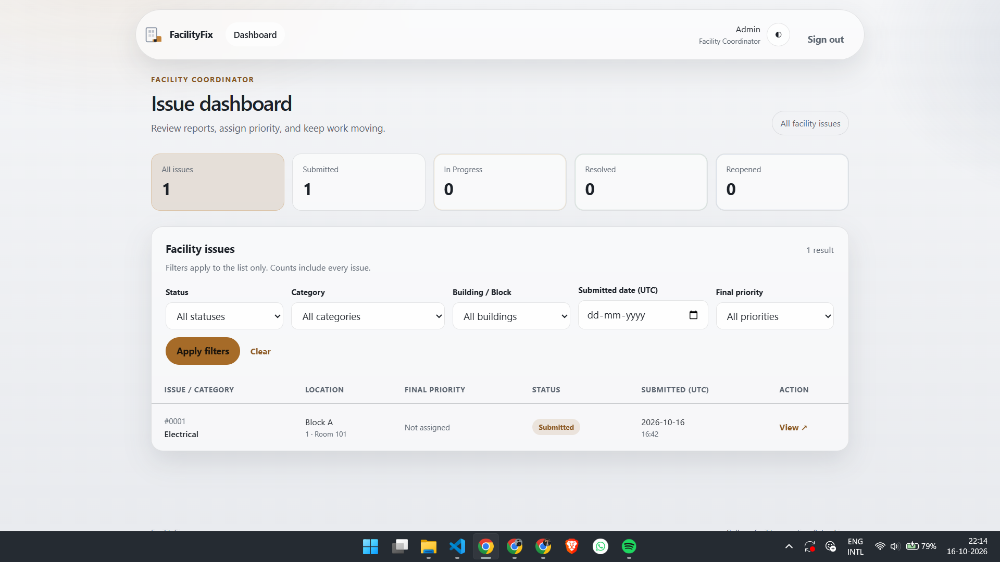

*The Facility Coordinator's dashboard.*

### 07. Issue Management

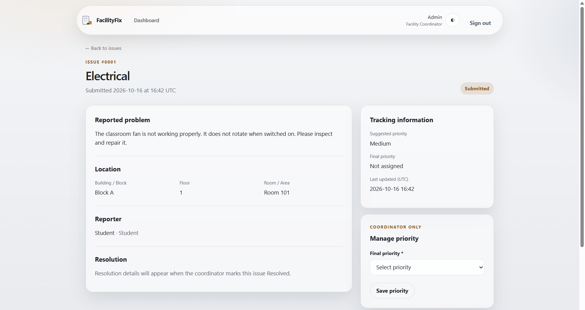

*The coordinator's issue management interface.*

### 08. Issue In Progress

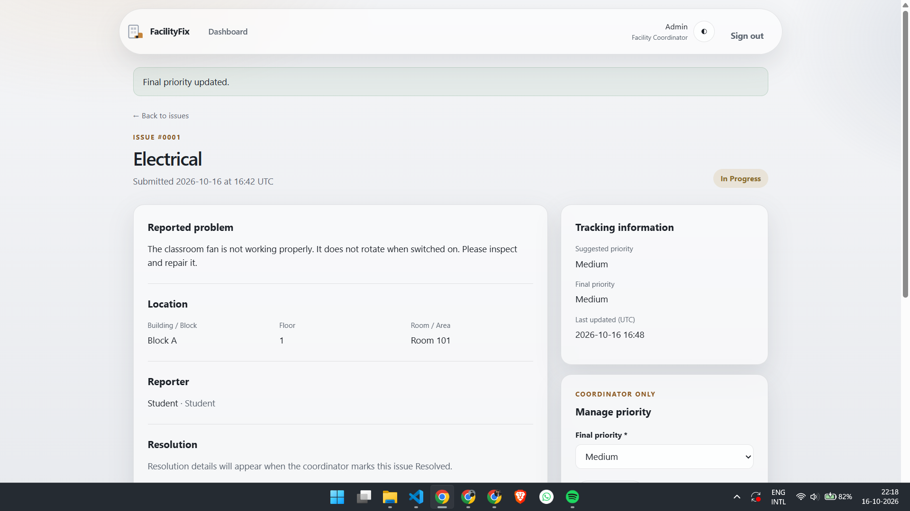

*An example of an issue in progress.*

### 09. Issue Resolved

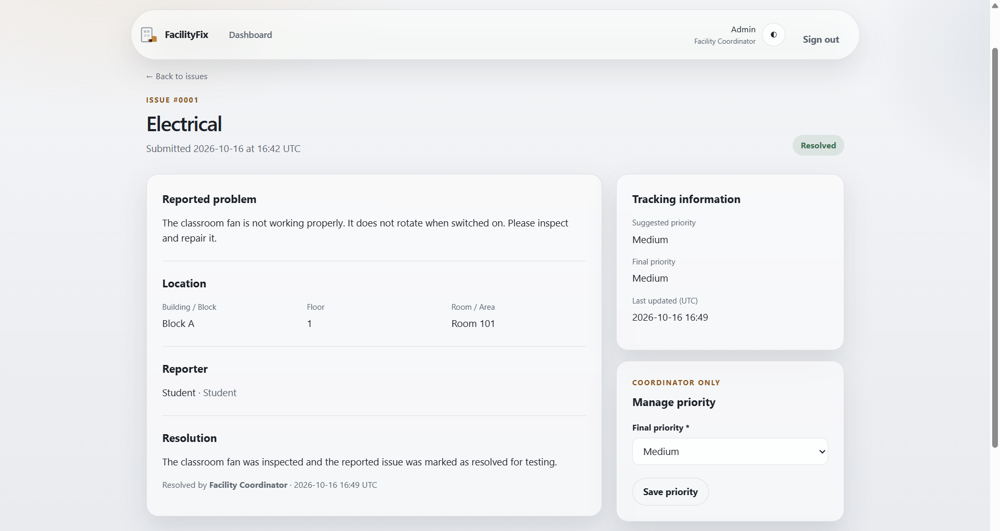

*An example of a resolved issue.*

### 10. Automated Test Results

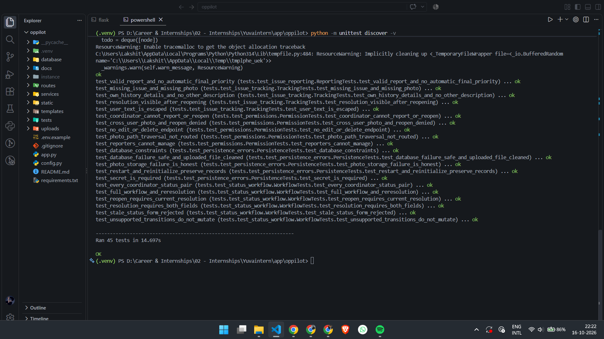

*Recorded output from the automated test suite.*

---

## Features

### User authentication and roles

FacilityFix supports four user roles:

| Role | Capabilities |
|---|---|
| Student | Submit and track facility issues |
| Faculty | Submit and track facility issues |
| Staff | Submit and track facility issues |
| Facility Coordinator | Manage issues, update status, and record resolutions |

User accounts are created through the application's command-line interface. Public self-registration is not included in the current setup.

### Issue reporting

Reporters can submit issues using a structured reporting workflow.

Supported categories:

- ⚡ Electrical
- 💻 IT & Computer
- 🪑 Furniture
- 🚰 Plumbing
- 🧹 Cleanliness & Sanitation
- 📌 Other

Issue reports can also include an optional image attachment.

### Issue tracking

Reporters can view their submitted issues and follow their current status.

### Coordinator dashboard

The Facility Coordinator can manage submitted issues, update their status and priority, and record repair or resolution notes.

### Issue lifecycle

The application supports the following workflow:

`Submitted → In Progress → Resolved`

Additional transitions:

- A reporter can reopen a resolved issue.
- The Facility Coordinator can move a reopened issue back to `In Progress`.

### Image upload validation

- Supported formats: JPEG and PNG.
- Maximum permitted file size: 2 MiB.
- Upload processing is handled by the application.

### Persistent database

SQLite stores application data. Database connection, schema, and issue repository responsibilities are separated into dedicated modules.

### Automated tests

The test suite covers authentication, coordinator operations, issue reporting, tracking, permissions, status transitions, and persistence-related error handling.

---

## How It Works

1. **Sign in:** A registered user logs into the application.
2. **Submit an issue:** A student, faculty member, or staff member reports a facility problem.
3. **Review:** The Facility Coordinator reviews the issue.
4. **Update progress:** The coordinator changes the status when work begins.
5. **Record resolution:** The coordinator records resolution information and marks the issue as resolved.
6. **Follow up:** The reporter can review issue history and reopen a resolved issue when necessary.

---

## Technology Stack

<p align="center">
  
  
  
  
  
  
  
</p>

| Technology | Purpose |
|---|---|
| Python | Backend application logic |
| Flask | Web framework and routing |
| SQLite | Relational data storage |
| HTML5 | Page structure |
| CSS3 | Styling and layout |
| JavaScript | Client-side interactions |
| Pillow | Image processing support |
| `unittest` | Automated testing |
| Git and GitHub | Version control and source hosting |

---

## Project Structure

```text
FacilityFix/
├── app.py
├── config.py
├── requirements.txt
├── .env.example
├── .gitignore
│
├── database/
│   ├── __init__.py
│   ├── connection.py
│   ├── issue_repository.py
│   └── schema.sql
│
├── routes/
│   ├── __init__.py
│   ├── auth_routes.py
│   ├── coordinator_routes.py
│   └── reporter_routes.py
│
├── services/
│   ├── __init__.py
│   ├── issue_service.py
│   ├── uploads.py
│   └── validation.py
│
├── static/
│   ├── css/style.css
│   ├── img/favicon.svg
│   ├── img/logo.svg
│   └── js/
│       ├── app.js
│       └── theme.js
│
├── templates/
│   ├── auth/
│   ├── coordinator/
│   ├── errors/
│   ├── issues/
│   └── reporter/
│
├── tests/
│   ├── common.py
│   ├── test_auth.py
│   ├── test_coordinator.py
│   ├── test_issue_reporting.py
│   ├── test_issue_tracking.py
│   ├── test_permissions.py
│   ├── test_persistence_errors.py
│   └── test_status_workflow.py
│
├── docs/
├── uploads/
└── screenshots/
```

---

## Installation

Follow these steps to run FacilityFix on your local machine.

### Prerequisites

- Python 3.11 or a compatible version.
- Git.
- PowerShell or another terminal.

### 1. Clone the repository

```bash
git clone https://github.com/hmmlavi/FacilityFix.git
cd FacilityFix
```

### 2. Create a virtual environment

For Windows PowerShell:

```powershell
py -3.11 -m venv .venv
.\.venv\Scripts\Activate.ps1
```

If Python 3.11 is unavailable, use an installed Python version compatible with the project dependencies.

### 3. Install dependencies

```powershell
python -m pip install -r requirements.txt
```

### 4. Configure the secret key

Generate a secret key for the current PowerShell session:

```powershell
$env:FACILITYFIX_SECRET_KEY = python -c "import secrets; print(secrets.token_hex(32))"
```

The application requires `FACILITYFIX_SECRET_KEY` before starting.

Use a private key for your own environment. Never commit actual secret values to the repository.

### 5. Initialize the database

```powershell
flask --app app init-db
```

### 6. Create a user

```powershell
flask --app app create-user
```

Follow the prompts to enter the username, display name, role, and password.

Available roles:

- `Student`
- `Faculty`
- `Staff`
- `Facility Coordinator`

### 7. Run the application

```powershell
flask --app app run
```

Open the application in your browser:

**http://127.0.0.1:5000**

Keep the terminal open while the application is running.

> The environment variable shown above is session-specific. If you open a new terminal, configure the secret key again before running Flask commands.

---

## Testing

FacilityFix uses Python's built-in `unittest` framework.

Run the automated tests:

```powershell
python -m unittest discover -v
```

### Recorded test result

```text
Ran 45 tests
OK
```

**45 tests passed in the recorded test run.**

Test coverage includes:

- Authentication.
- Coordinator functionality.
- Issue reporting.
- Issue tracking.
- Role-based permissions.
- Issue status workflow.
- Persistence-related errors.

The recorded result reflects the automated test run. It does not, by itself, establish that all browser, accessibility, and production deployment checks have been completed.

---

## Security Considerations

The application includes authentication, role-based access checks, server-side validation, configurable secret-key handling, and image upload restrictions.

Before deploying publicly, additional review should cover:

- Production secret management.
- Debug configuration.
- Session and authentication security.
- File upload storage and access.
- Database backups and recovery.
- Production web server configuration.
- Responsive design and accessibility.

Do not expose a development server directly to the public internet.

---

## Documentation

Supporting project documentation is available in the [`docs/`](docs/) directory.

- [`Requirements Checklist`](docs/requirements-checklist.md)
- [`Verification Notes`](docs/verification.md)

The repository also includes supporting internship project documents. Refer to the files in `docs/` for the available planning and verification material.

---

## Future Improvements

Potential future enhancements include:

- Email or in-app notifications.
- Advanced issue filtering and search.
- Reporting dashboards and analytics.
- More extensive accessibility checks.
- Production deployment and monitoring.
- Improved operational reporting.

These are possible future improvements and are not claims that the features are already implemented.

---

## Author

**Lakshit Singh Saini**

B.Tech — Computer Science & Engineering

**Project:** FacilityFix — College Facility Issue Reporting & Tracking System

- **Repository:** [hmmlavi/FacilityFix](https://github.com/hmmlavi/FacilityFix)

---

## 🚀 About the Project

FacilityFix is a software development project focused on making college facility issue reporting and tracking more organized, transparent, and efficient. It demonstrates the practical application of web development, database management, authentication, role-based access control, and structured issue workflows.

The project is designed with extensibility in mind, providing a foundation for future improvements such as notifications, analytics, and deployment in real-world environments.

**FacilityFix is an independently demonstrable project built for learning, experimentation, and practical software development.**

---

<p align="center">
  <strong>FacilityFix</strong><br>
  Bringing structure to facility issue reporting and tracking.
</p>
